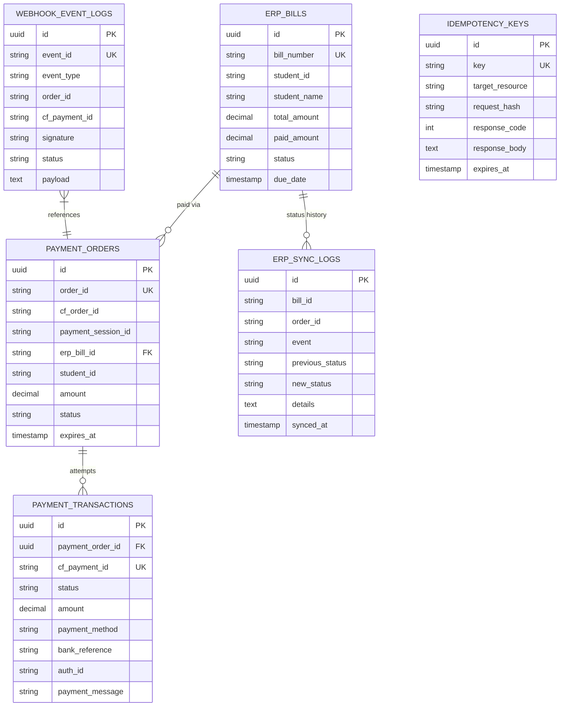
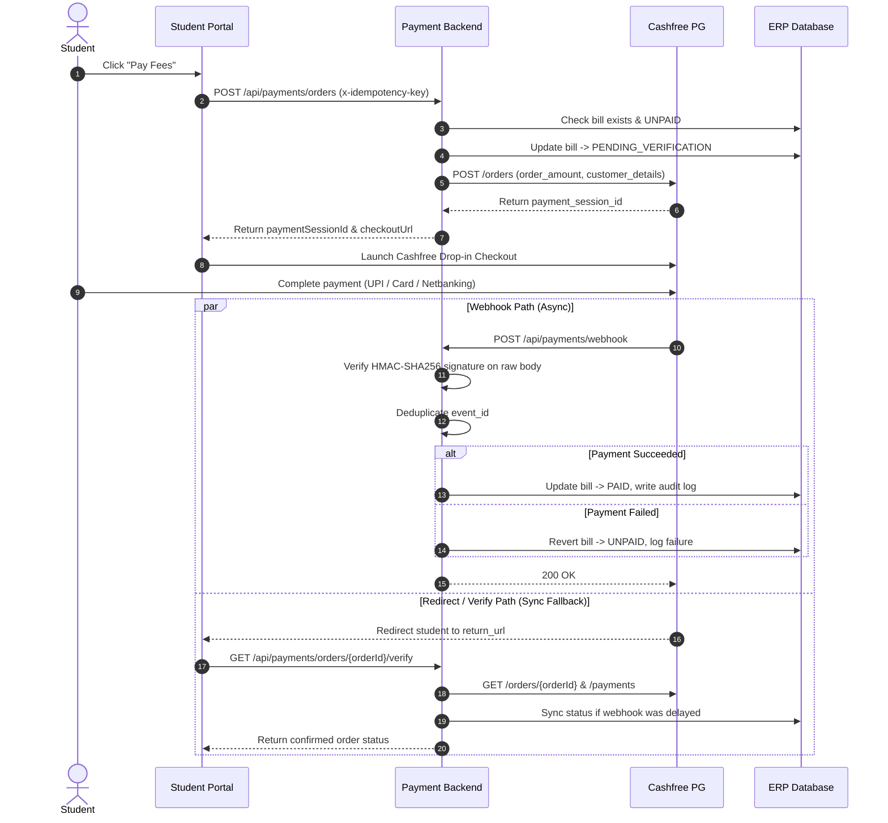

# Cashfree Payment Gateway Integration for UMS / ERP

Backend payment service for a University Management System (UMS) built with NestJS, TypeScript, and TypeORM. It handles student fee payments via Cashfree Payment Gateway, from bill generation to checkout session creation, webhook processing, and ERP balance updates.

---

## Tech Stack

- **Framework**: NestJS (Express)
- **Language**: TypeScript
- **Database / ORM**: PostgreSQL via TypeORM (SQLite in-memory used for tests and zero-setup local dev)
- **Payment Gateway**: Cashfree Payment Gateway API `2023-08-01`
- **Testing**: Jest (Unit) & Supertest (E2E)
- **API Docs**: Swagger UI (`/api/docs`)

---

## Architecture & Database Design

The database tracks the full lifecycle across 6 tables to keep payment gateway data separate from the university fee ledger.



### Table Roles
- `erp_bills`: Source of truth for student invoices (`UNPAID`, `PENDING_VERIFICATION`, `PARTIALLY_PAID`, `PAID`).
- `payment_orders`: Cashfree orders created against a bill. Tracks `payment_session_id` and order status.
- `payment_transactions`: Individual attempts under an order. Stores Cashfree payment ID, payment mode (UPI, Netbanking, Card), bank UTR, and failure reasons.
- `webhook_event_logs`: Raw payload audit trail. Used to detect and drop duplicate webhook deliveries.
- `idempotency_keys`: Caches request hashes and API responses to prevent duplicate order generation.
- `erp_sync_logs`: Audit log tracking every balance or status change pushed to an ERP bill.

Migration file: `src/database/migrations/1727876428912-InitialPaymentSchema.ts`.

---

## Payment Lifecycle Flow



---

## Key Design Decisions & Gotchas

### 1. Dual-Channel Reconciliation (Webhooks + `/verify`)
Webhooks are asynchronous and can be delayed by network latency, retries, or server maintenance. 
- Webhooks handle the background update automatically.
- When the student finishes payment and lands on the frontend `return_url`, the frontend calls `GET /api/payments/orders/:orderId/verify`. This polls Cashfree's `/orders/{orderId}/payments` directly and updates the ERP bill on the spot.
- Both paths are idempotent, so whichever arrives first updates the bill without conflict.

### 2. Webhook Signature Verification & Raw Body Handling
Cashfree signs webhooks with HMAC-SHA256 using `timestamp + rawBody`.
- **The catch**: If Express parses JSON into an object first, formatting differences (spaces, key ordering) change the raw string, causing signature checks to fail even on valid requests.
- **The fix**: In `src/main.ts`, we capture the untouched byte buffer on the request object using the Express `verify` callback (`req.rawBody = buf.toString('utf8')`).
- Signatures are compared using `crypto.timingSafeEqual` to avoid timing side-channel attacks.

### 3. Preventing Double-Charges (Idempotency)
If a student double-clicks "Pay" or their connection drops mid-request:
- Clients send an `x-idempotency-key` header (e.g. UUID).
- We hash the request payload with SHA-256 and store it in `idempotency_keys`.
- If the same key arrives with the exact same payload, we immediately return the cached response without creating a second order on Cashfree.
- If the key is reused with a different payload, we reject it with `409 Conflict`.

### 4. 1-to-Many Payment Attempts per Order
Students frequently fail an initial payment attempt (insufficient balance, cancelled UPI prompt) and retry with another method. 
- Instead of creating a brand new order every time, `payment_orders` links to multiple `payment_transactions`.
- Every attempt records its own `cf_payment_id`, method, bank UTR, and failure reason.

### 5. Mock Mode for Zero-Setup Local Testing
Testing payment gateways locally usually means setting up ngrok or waiting for sandbox credentials.
- When `CASHFREE_MOCK_MODE=true` (the default in `.env.example`), the service simulates Cashfree responses in-memory.
- You can trigger test webhooks via `POST /api/payments/webhook/simulate` to test full success or failure paths without external tools.
- Switching to the real Cashfree sandbox only requires adding your credentials in `.env` and setting `CASHFREE_MOCK_MODE=false`.

---

## Quick Start

### 1. Requirements
- Node.js 18+
- npm 9+

### 2. Installation
```bash
git clone <repo-url>
cd backend
npm install
```

### 3. Environment Setup
```bash
cp .env.example .env
```

Defaults in `.env` are configured for local development using SQLite and Mock Mode:
```env
PORT=3000
DB_TYPE=sqlite
CASHFREE_ENVIRONMENT=SANDBOX
CASHFREE_MOCK_MODE=true
```

To connect to live Cashfree Sandbox, set:
```env
CASHFREE_MOCK_MODE=false
CASHFREE_ENVIRONMENT=SANDBOX
CASHFREE_APP_ID=your_sandbox_app_id
CASHFREE_SECRET_KEY=your_sandbox_secret_key
```

### 4. Run Migrations
```bash
npm run migration:run
```

### 5. Start Service
```bash
# Dev server
npm run start:dev

# Or build & run
npm run build
npm run start:prod
```

- API Base: `http://localhost:3000/api`
- Swagger UI: `http://localhost:3000/api/docs`

---

## API Reference

### 1. Create Student Fee Bill
Creates an unpaid fee record in the ERP.

```bash
curl -X POST http://localhost:3000/api/erp/bills \
  -H "Content-Type: application/json" \
  -d '{
    "billNumber": "BILL-2026-001",
    "studentId": "STU1001",
    "studentName": "Aarav Sharma",
    "studentEmail": "aarav.sharma@university.edu",
    "studentPhone": "9876543210",
    "title": "Semester 4 Tuition Fee",
    "totalAmount": 25000,
    "dueDate": "2026-11-30T00:00:00.000Z"
  }'
```

**Response (`201 Created`):**
```json
{
  "id": "c1f7b0a8-3829-4b21-827c-9ef14c99591e",
  "billNumber": "BILL-2026-001",
  "studentId": "STU1001",
  "studentName": "Aarav Sharma",
  "totalAmount": 25000,
  "paidAmount": 0,
  "status": "UNPAID",
  "createdAt": "2026-10-03T10:00:00.000Z"
}
```

---

### 2. Initiate Payment Order
Initiates an order on Cashfree and marks the bill `PENDING_VERIFICATION`. Supports `x-idempotency-key`.

```bash
curl -X POST http://localhost:3000/api/payments/orders \
  -H "Content-Type: application/json" \
  -H "x-idempotency-key: fee-bill-2026-001-attempt-1" \
  -d '{
    "erpBillId": "BILL-2026-001",
    "studentId": "STU1001",
    "studentName": "Aarav Sharma",
    "studentEmail": "aarav.sharma@university.edu",
    "studentPhone": "9876543210",
    "amount": 25000,
    "currency": "INR",
    "orderNote": "Semester 4 Tuition"
  }'
```

**Response (`201 Created`):**
```json
{
  "orderId": "ORD_UMS_1727876428_8F3B",
  "cfOrderId": "918273645",
  "paymentSessionId": "session_sim_a7d9f2e8...",
  "erpBillId": "BILL-2026-001",
  "studentId": "STU1001",
  "studentName": "Aarav Sharma",
  "amount": 25000,
  "currency": "INR",
  "status": "ACTIVE",
  "checkoutUrl": "https://payments-test.cashfree.com/order/#session_sim_a7d9f2e8...",
  "returnUrl": "http://localhost:3000/api/payments/return?order_id=ORD_UMS_1727876428_8F3B",
  "createdAt": "2026-10-03T10:05:00.000Z"
}
```

---

### 3. Verify Payment & Sync ERP
Actively checks Cashfree for payment status and reconciles the ERP bill.

```bash
curl http://localhost:3000/api/payments/orders/ORD_UMS_1727876428_8F3B/verify
```

**Response (`200 OK`):**
```json
{
  "orderId": "ORD_UMS_1727876428_8F3B",
  "erpBillId": "BILL-2026-001",
  "orderStatus": "SUCCESS",
  "isPaid": true,
  "amount": 25000,
  "transactions": [
    {
      "cfPaymentId": "88776655",
      "status": "SUCCESS",
      "amount": 25000,
      "paymentMethod": "upi",
      "bankReference": "UTR99887766",
      "paymentMessage": "Transaction Successful",
      "paymentTime": "2026-10-03T10:06:12.000Z"
    }
  ],
  "erpSyncStatus": "ERP Bill updated to PAID and synced successfully"
}
```

---

### 4. Cashfree Webhook Listener
Receives signed Cashfree webhooks and syncs the bill.

- **Endpoint**: `POST /api/payments/webhook`
- **Headers**:
  - `x-webhook-signature`: HMAC-SHA256 signature
  - `x-webhook-timestamp`: Epoch timestamp

---

### 5. Local Webhook Simulator
For local testing without webhooks or ngrok:

```bash
# Simulate successful payment
curl -X POST http://localhost:3000/api/payments/webhook/simulate \
  -H "Content-Type: application/json" \
  -d '{
    "orderId": "ORD_UMS_1727876428_8F3B",
    "status": "SUCCESS"
  }'

# Simulate failed payment
curl -X POST http://localhost:3000/api/payments/webhook/simulate \
  -H "Content-Type: application/json" \
  -d '{
    "orderId": "ORD_UMS_1727876428_8F3B",
    "status": "FAILED"
  }'
```

---

### 6. ERP Audit Logs
View status change history for any bill:

```bash
curl http://localhost:3000/api/erp/bills/BILL-2026-001/sync-logs
```

**Response (`200 OK`):**
```json
[
  {
    "id": "e82b7c61-...",
    "billId": "BILL-2026-001",
    "orderId": "ORD_UMS_1727876428_8F3B",
    "event": "WEBHOOK_PAYMENT_SUCCESS",
    "previousStatus": "PENDING_VERIFICATION",
    "newStatus": "PAID",
    "details": {
      "paidAmount": 25000,
      "cfPaymentId": 88776655,
      "bankReference": "UTR99887766"
    },
    "syncedAt": "2026-10-03T10:06:15.000Z"
  }
]
```

---

### 7. Payment Analytics
Summary stats on collection volume and payment success rates.

```bash
curl http://localhost:3000/api/payments/analytics
```

**Response (`200 OK`):**
```json
{
  "totalOrders": 12,
  "successfulOrders": 10,
  "failedOrders": 1,
  "pendingOrders": 1,
  "totalRevenueCollected": 250000,
  "successRatePercentage": 83.33
}
```

---

## Testing

```bash
# Unit tests
npm test

# End-to-end integration tests (checks order creation, idempotency, signature verification, ERP sync)
npm run test:e2e
```
